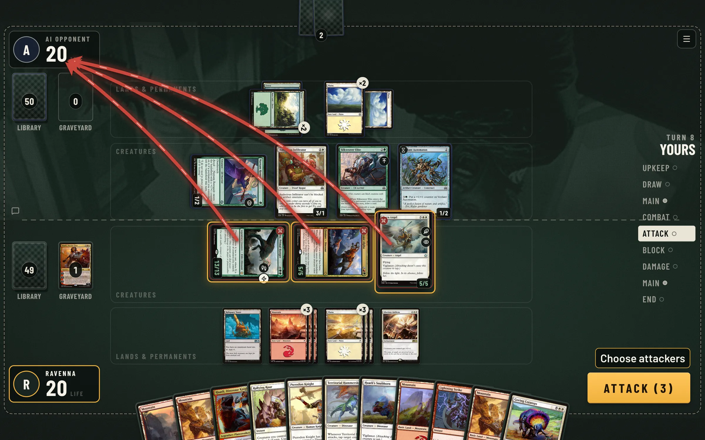
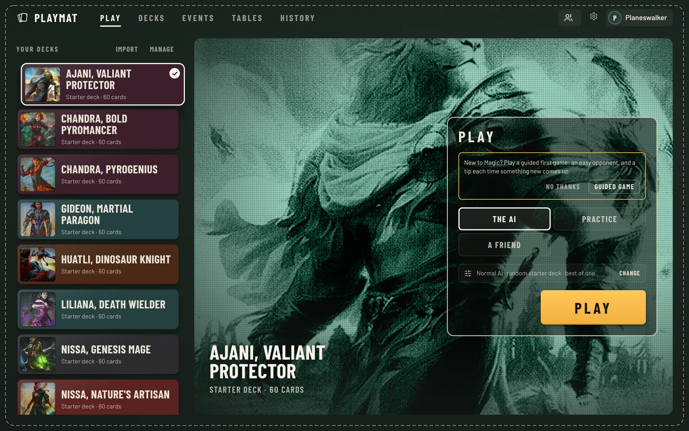
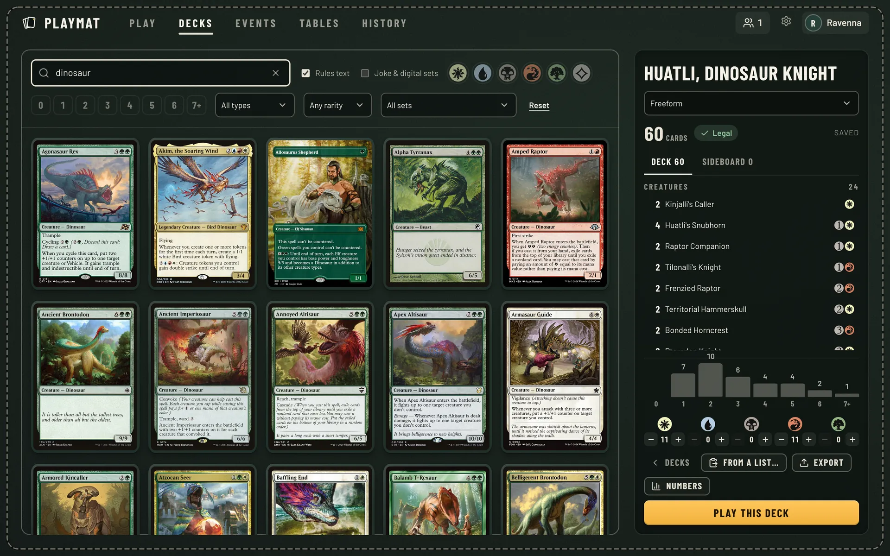
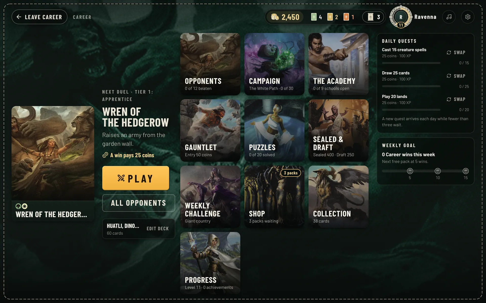
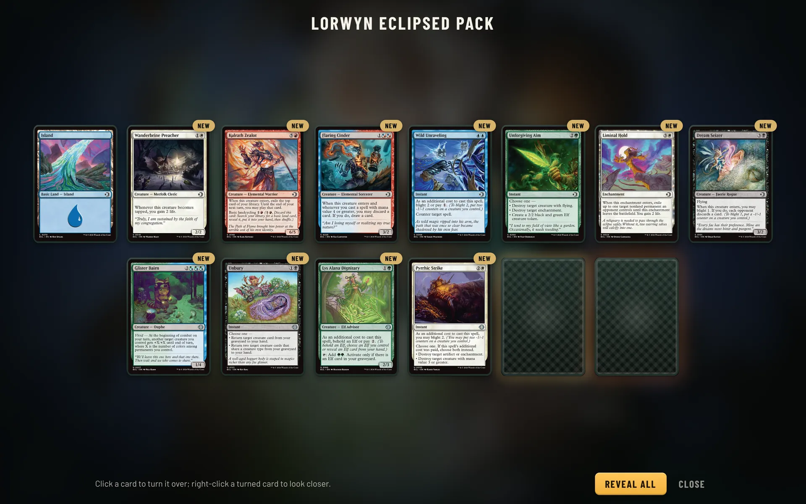
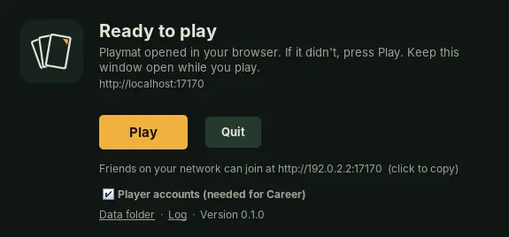

<p align="center">
  <picture>
    <source media="(prefers-color-scheme: dark)" srcset="brand/playmat-logo.svg">
    
  </picture>
</p>

<p align="center">
  A fan-made web client for <a href="https://github.com/magefree/mage">XMage</a>, the open-source Magic: The Gathering
  rules engine. A hobby project, not affiliated with Wizards of the Coast.
</p>

<p align="center">
  <a href="https://github.com/arcanite24/playmat/releases/latest/download/Playmat-Setup-Windows-x64.exe"></a>
  <a href="#play-on-your-computer"></a>
  <a href="#play-on-your-computer"></a>
</p>

<p align="center">
  <a href="https://arcanite24.github.io/playmat/">Website</a> ·
  <a href="#play-on-your-computer">Download</a> ·
  <a href="#running-a-server">Run a server</a> ·
  <a href="#working-on-playmat">Working on Playmat</a> ·
  <a href="docs/WebSocketAPI.md">WebSocket API</a>
</p>

<p align="center">
  <a href="https://github.com/arcanite24/playmat/releases/latest"></a>
  <a href="https://github.com/arcanite24/playmat/actions/workflows/web-client.yml"></a>
  <a href="LICENSE.txt"></a>
  
</p>

<p align="center">
  <a href="https://discord.gg/SFQKFrTvww"></a>
  <a href="https://ko-fi.com/nerijs"></a>
</p>



## What it is

Playmat is a fork of [XMage](https://github.com/magefree/mage), the open-source Magic rules engine with its cards, AI
opponents, drafts and tournaments. It adds a WebSocket bridge to the server and a browser client styled after MTG
Arena. [Install it on your computer](#play-on-your-computer) to play the AI, Career or friends on your Wi-Fi, or
[run a server](#running-a-server) for a group that plays from anywhere. The engine stays XMage, merged from upstream
regularly, so the cards it supports work here too.

It's a work in progress with rough edges. Bug reports and pull requests are welcome.

Come say hi, find a game or report bugs on the [Discord server](https://discord.gg/SFQKFrTvww). If you'd like to help
keep the server running, you can [support the project on Ko-fi](https://ko-fi.com/nerijs).

## Features

- **Playing.** Pick a deck and play the AI, or send a friend an invite link. Practice mode gives you a
  goldfish opponent and tools to put any card in hand or on the battlefield.
- **The board.** Attack arrows, a visible stack, priority shown on the table, auto-pass with the stops you choose, and
  keyboard shortcuts for passing and answering.
- **Decks.** A deck builder with card search, and an import sheet that takes a link from Archidekt,
  Moxfield and other deck sites, a pasted list or a `.dck` file. Starter decks are there from the first sign-in,
  Commander ones included.
- **Events.** Booster draft, sealed, Jumpstart and constructed tournaments. Empty seats fill with AI players.
- **Career.** An optional single-player mode: five colour campaigns with a boss at the end of each, an Academy with a school
  for every format, puzzles, a gauntlet, sealed and draft runs, a weekly challenge, booster packs to open, a collection
  to craft into and achievements, illustrated with AI-generated art.
- **Social.** Lobby chat, players online, profiles, a table browser, spectating, match history and replays.
- **Devices.** Desktop browsers, tablets, an installable web app and an Android app that keeps card
  pictures on the device. English and Spanish.
- **On your computer.** Installers for Windows, macOS and Linux with everything inside, Java included: install,
  open, play. Friends on the same network join from their browser.
- **Hosting.** One Docker Compose stack: the server, Caddy with automatic HTTPS, a Scryfall picture cache,
  nightly backups and Discord notifications.

<table>
  <tr>
    <td></td>
    <td></td>
  </tr>
  <tr>
    <td></td>
    <td></td>
  </tr>
</table>

## Play on your computer

One download with everything inside, Java included. Install it, open Playmat, and the game opens in your browser. Play
the AI and Career on your own, or have friends on the same Wi-Fi join you. Nothing else to install.

<p align="center"></p>

| Your computer | Download |
|---|---|
| **Windows** 10 or 11 | [Playmat-Setup-Windows-x64.exe](https://github.com/arcanite24/playmat/releases/latest/download/Playmat-Setup-Windows-x64.exe): run it and press **Install** |
| **Mac** with Apple silicon (M1 and later) | [Playmat-macOS-arm64.dmg](https://github.com/arcanite24/playmat/releases/latest/download/Playmat-macOS-arm64.dmg): drag Playmat to Applications |
| **Mac** with an Intel processor | [Playmat-macOS-x64.dmg](https://github.com/arcanite24/playmat/releases/latest/download/Playmat-macOS-x64.dmg): drag Playmat to Applications |
| **Linux** (x64 or ARM) | `curl -fsSL https://github.com/arcanite24/playmat/releases/latest/download/install.sh \| sh` |

Prefer a terminal? These download the right file, install it and start Playmat, without the warnings below:

```bash
# macOS or Linux
curl -fsSL https://github.com/arcanite24/playmat/releases/latest/download/install.sh | sh
```

```powershell
# Windows (PowerShell)
irm https://github.com/arcanite24/playmat/releases/latest/download/install.ps1 | iex
```

**The first time**

- Windows may say it protected your PC: choose **More info**, then **Run anyway**. macOS may say it can't check
  Playmat: open **System Settings**, **Privacy & Security** and choose **Open Anyway**. Playmat is a free fan project
  without paid signing certificates; the terminal installers above skip both screens.
- The first start prepares the card database, which takes a few minutes once. Your computer may ask whether Playmat
  (Java) may accept network connections: allowing it lets friends on your network join.

**Playing**

- A small Playmat window shows what's happening and opens `http://localhost:17170` in your browser when the game is
  ready. Keep it open while you play; closing it stops the game.
- Create an account the first time; it stays on your computer and unlocks Career. Untick **Player accounts** in the
  Playmat window to sign in with just a name instead.
- Friends on the same network open the address the window shows, such as `http://192.168.1.20:17170`.
- Card pictures come from Scryfall, so an internet connection helps.
- The window tells you when a new version is out. Installing it keeps your accounts, decks and Career progress.

Every version is on the [releases page](https://github.com/arcanite24/playmat/releases).
[ops/desktop/README.md](ops/desktop/README.md) covers how the app works, where it keeps its data and how releases are
built.

## Running a server

You need Docker and a machine your players can reach.

```bash
cp ops/web/.env.example ops/web/.env      # set DOMAIN, XMAGE_ADMIN_PASSWORD, XMAGE_AUTH
docker compose -f ops/web/docker-compose.yml up -d --build
```

Players open `https://<your domain>` and sign in. The first build compiles the card database, which takes a while.
[ops/web/README.md](ops/web/README.md) covers private LAN servers, running behind another reverse proxy, every setting,
accounts and moderation, Discord notifications, backups and capacity.

## Working on Playmat

To run it from source while you change it. Requirements: JDK 17 or later, Maven, and the Node.js version in [`Mage.Web.Client/.nvmrc`](Mage.Web.Client/.nvmrc).

```bash
# 1. build the server (a few minutes the first time)
mvn -T 1C -pl '!Mage.Client,!Mage.Server.Console,!Mage.Tests,!Mage.Verify,!Mage.Reports' install -DskipTests

# 2. start it: the WebSocket bridge listens on ws://localhost:17172
cd Mage.Server/release
mvn -f ../../pom.xml -pl Mage.Server -Dexec.mainClass=mage.server.Main exec:java

# 3. in another terminal, start the client on http://localhost:5173
cd Mage.Web.Client
npm ci
npm run dev
```

Sign in with any name. The client's own guide, [Mage.Web.Client/README.md](Mage.Web.Client/README.md), covers its
architecture, tests and the Android build (`npm run android`).

## Repository map

| Path | What lives there |
|---|---|
| [`Mage.Web.Client`](Mage.Web.Client) | The Playmat client: React 19, TypeScript, Vite. Product brief in [PRODUCT.md](Mage.Web.Client/PRODUCT.md), design system in [DESIGN.md](Mage.Web.Client/DESIGN.md). |
| [`Mage.Server`](Mage.Server) | XMage's server, plus the JSON-RPC WebSocket bridge and Career services (`src/main/java/mage/server/websocket`, `.../career`). |
| [`ops/web`](ops/web) | The Docker Compose deployment kit. |
| [`ops/desktop`](ops/desktop) | The desktop app: a launcher and installers for Windows, macOS and Linux. |
| [`docs`](docs) | The WebSocket API, data models and the upstream merge recipe. |
| [`brand`](brand) | The Playmat logo, generated from the app's typeface by `build_logo.py`. |
| [`site`](site) | The project website, published to GitHub Pages. |
| Everything else | XMage: the rules engine, card implementations, AI, tests and the original desktop client. |

## Credits

Playmat stands on XMage and the many people who have built it since 2010: the rules engine, tens of thousands of card
implementations and the AI are their work. Card and rules bugs usually live in the engine; XMage's
[issue tracker](https://github.com/magefree/mage/issues) and [wiki](https://github.com/magefree/mage/wiki) are the
places for those. Card pictures and data come from [Scryfall](https://scryfall.com).

Released under the [MIT License](LICENSE.txt), like XMage.

Playmat is unofficial Fan Content permitted under the Fan Content Policy. Not approved/endorsed by Wizards. Portions
of the materials used are property of Wizards of the Coast. ©Wizards of the Coast LLC.
